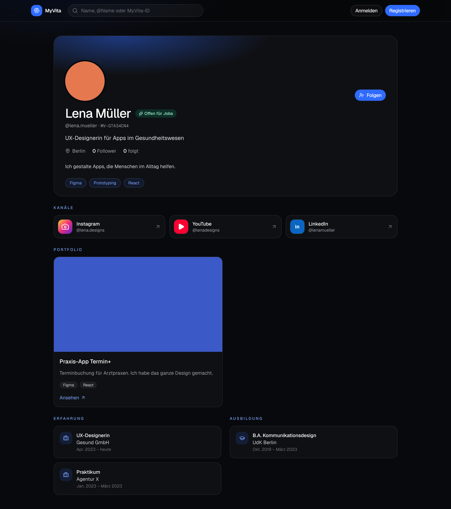
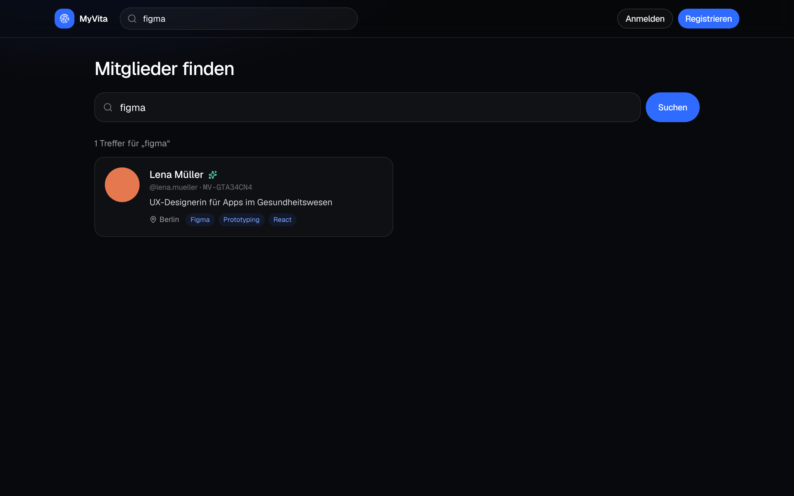
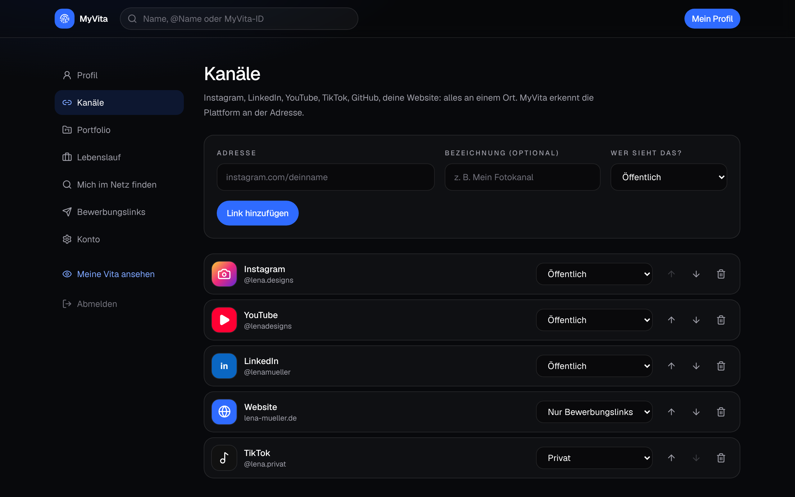

# MyVita

**Deine Vita. Alles an einem Ort.**

Das Netzwerk für Lebenslauf, Portfolio und alle deine Kanäle.

## Worum es geht

Auf MyVita legt jede Person ihre eigene Vita an: Lebenslauf, Projekte und alle Kanäle wie Instagram, LinkedIn, YouTube oder TikTok, gebündelt auf einer Seite. Andere finden sie über den Namen, den @Namen oder die MyVita-ID. Für Bewerbungen gibt es private Links, die ablaufen.

- **Alle Kanäle gebündelt.** Instagram, LinkedIn, YouTube, TikTok, GitHub, Website und mehr. MyVita erkennt die Plattform an der Adresse.
- **Portfolio.** Programme, Apps, Designs und Videos mit Bild, Beschreibung und Link.
- **Lebenslauf.** Erfahrung und Ausbildung, immer aktuell.
- **Selbst bestimmen, wer was sieht.** Jeder Eintrag ist öffentlich, nur für Bewerbungslinks oder privat.
- **Bewerben per Link.** Ein privater Link pro Bewerbung. Er läuft ab, und man sieht, wie oft er geöffnet wurde.
- **Netzwerk.** Mitglieder finden nach Name, @Name, MyVita-ID, Fähigkeit oder Ort und ihnen folgen.
- **Mich im Netz finden.** MyVita sucht im Netz nach dem eigenen Namen. Treffer übernimmt man mit einem Klick.

## Ansichten

### Die Vita einer Person

### Mitglieder finden

### Eigenes Profil bearbeiten

## Technik

Next.js 16, React 19, TypeScript, Tailwind CSS, Drizzle ORM und Postgres. Gedacht für Supabase (Datenbank) und Cloudflare (Hosting). Der Code liegt im Ordner [`myindex`](myindex). Dort steht in der [Anleitung](myindex/README.md), wie man die App lokal startet und online stellt.
