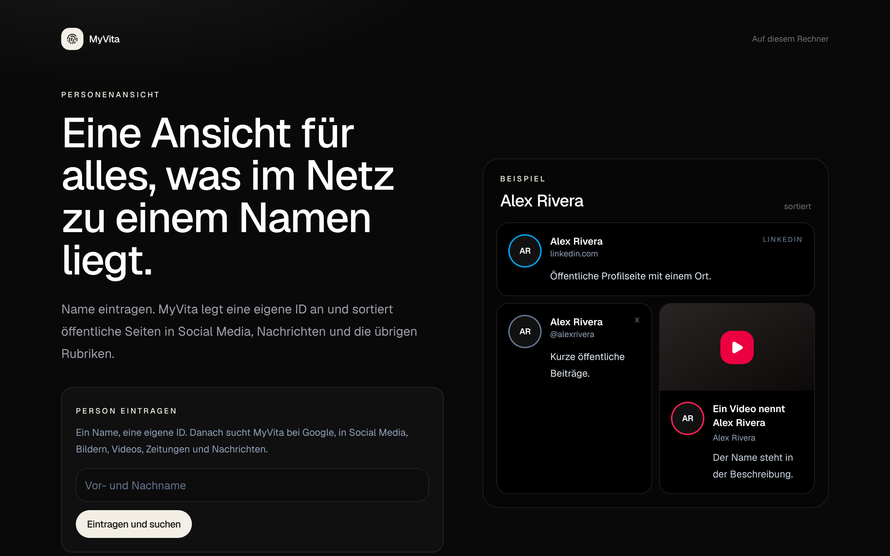
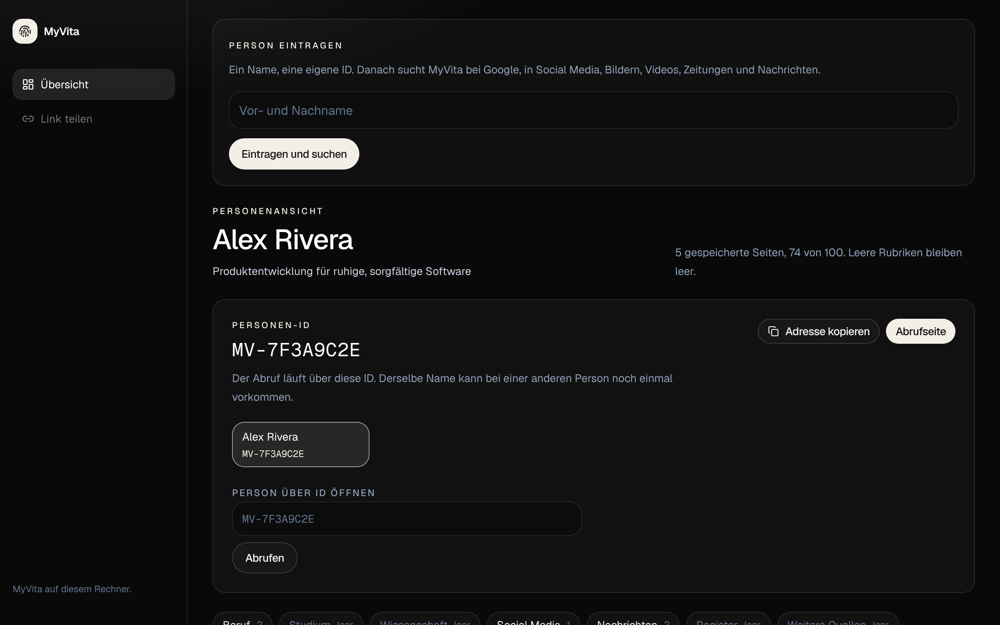
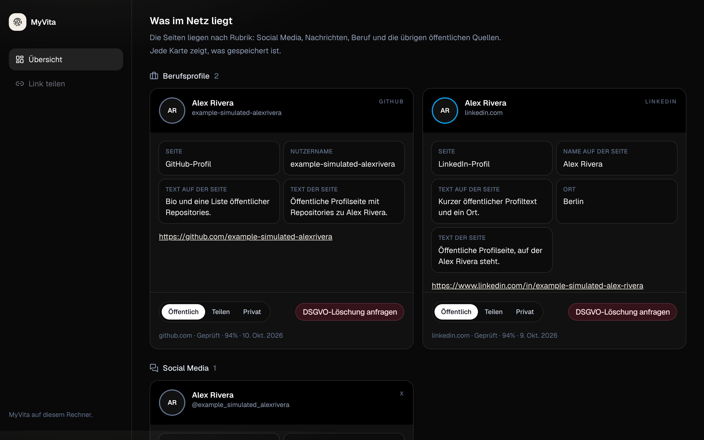
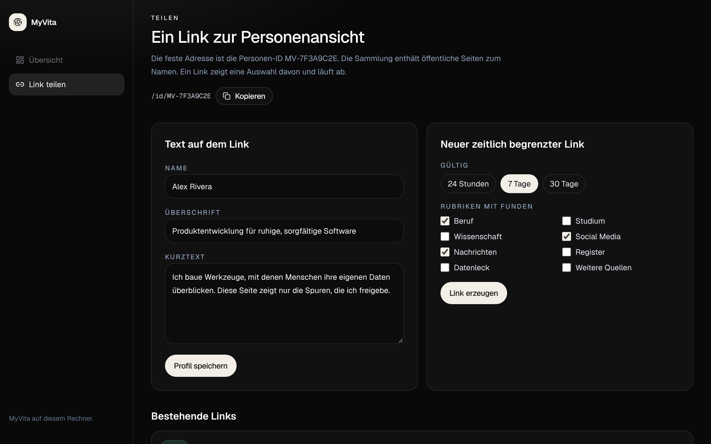

<div align="center">

# MyVita

**Eine Ansicht für alles, was im Netz zu einem Namen liegt.**

### [▶ Live-Vorschau öffnen](https://wabble1508-dotcom.github.io/myvita/)

</div>



## Worum es geht

MyVita sammelt öffentliche Seiten zu einer Person und ordnet sie übersichtlich. Man trägt einen Namen ein, MyVita vergibt eine eigene Personen-ID und sortiert die Funde nach Rubrik: Beruf, Social Media, Nachrichten, Videos und weitere öffentliche Quellen.

- **Eigene ID pro Person.** Gleiche Namen bleiben getrennte Personen.
- **Nach Quelle sortiert.** Google, Social Media, Bilder, Videos, Zeitungen und Nachrichten. Leere Rubriken bleiben leer.
- **Sichtbarkeit pro Fund.** Jeder Fund ist öffentlich, teilbar oder privat. Bei Bedarf lässt sich direkt eine DSGVO-Löschung anfragen.
- **Links zum Teilen.** Ein Link zeigt eine Auswahl der Funde und läuft nach 24 Stunden, 7 Tagen oder 30 Tagen ab.

## Ansichten

### Personenansicht



### Funde nach Rubrik



### Link teilen



> Die Live-Vorschau zeigt das Beispielprofil „Alex Rivera“ zum Durchklicken. Eingaben und Suche sind dort abgeschaltet.

## Technik

Next.js 16, React 19, TypeScript, Tailwind CSS. Der Code liegt im Ordner [`myindex`](myindex).

```bash
cd myindex
npm install
npm run dev
```

Danach läuft die App unter http://localhost:3000.
